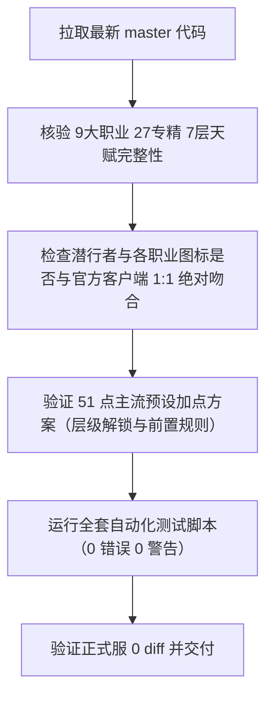

# 《魔兽世界》小程序 - 60级/无限服全职业天赋系统需求与核查文档

> **面向协同 AI 的交接需求说明**  
> 本文档旨在指导后续接入的代码评审 AI 或开发 AI，通过 Git 仓库对本小程序的天赋树模拟器进行全方位深度审查与修复，确保其与《魔兽世界》游戏内的真实体验、界面展示及权威数据 100% 严密对齐。

---

## 一、 项目工程范围与严格隔离红线（Strict Isolation Boundary）

1. **Git 仓库地址**：`https://git.weixin.qq.com/277166525/winds.git`
2. **工程类型**：原生微信小程序（Native WeChat Mini-Program，技术栈为 WXML / WXSS / JavaScript / JSON）。
3. **【绝对红线·严禁触碰】正式服模块（Formal Server）**：
   * 本小程序包含两大独立业务板块：**正式服（当前 12.0 大秘境/团本/BIS装备库/MDT路线/职业宏）** 与 **60级/无限服专区（经典旧世/Forever特色服天赋/地下城/愿望池）**。
   * **正式服文件必须严格保持 `0 diff`（绝对禁止改动任何一行代码）**，受保护文件包括但不限于：
     * 页面目录：`pages/mdt/`, `pages/loot/`, `pages/bis/`, `pages/bis-detail/`, `pages/build/`, `pages/meta/`, `pages/topmeta/`, `pages/token/`, `pages/macros/`, `pages/admin/`, `pages/webview/`
     * 核心数据：`data/loot.js`, `data/wow_equipment_db.js`, `data/wow_guides_data.js` 等
   * 提交前必须执行校验：`git diff f8e8bc3 -- pages/mdt pages/loot pages/bis pages/build pages/meta pages/topmeta pages/token pages/macros data/loot.js data/wow_equipment_db.js data/wow_guides_data.js`，输出必须为空。

4. **本次需求涉及的文件清单（In-Scope Files）**：
   * 页面展示与交互：`pages/infinite-talents/infinite-talents.wxml`, `infinite-talents.js`, `infinite-talents.wxss`, `infinite-talents.json`
   * 天赋核心数据库：`data/infinite_talents_data.js`, `data/infinite_data.js`
   * 自动化构建脚本：`scripts/build_infinite_latest_talents.js`
   * 质量审计与体检脚本：`scripts/audit_talent_data.js`, `scripts/audit_system.js`, `scripts/verify_all.js`

---

## 二、 业务背景与用户核心痛点（User Feedback & Problem Statement）

用户在小程序真机中体验【60级天赋系统】时，强烈反馈**“天赋树有很大问题，缺少很多天赋，图片要用跟游戏里一样的图片，跟游戏的最新天赋有区别，要求必须做到跟游戏里一模一样”**。

具体表现为以下核心疑点与诉求：

### 1. 潜行者（DZ）等职业的天赋完整性与真实性
* **天赋缺失与技能遗漏**：早期版本中部分专精缺少深层天赋（例如第 6~7 层断层，没有 31 点终极天赋）。
* **【强化剔骨】与【强化凿击】的归属与图标**：
  * 用户明确质疑：潜行者的【强化剔骨】和【强化凿击】图标是否做反了，还是两个天赋放反了？
  * 需核查：在真实游戏客户端中，刺杀系第一行第一列为【强化剔骨】（增加剔骨伤害），战斗系第一行第一列为【强化凿击】（增加凿击瘫痪时间）；暴雪底层给剔骨分配的图标是出拳动作（`ability_rogue_eviscerate`），给凿击分配的是裂肉见骨动作（`ability_gouge`）。需要确认在当前前端 UI 渲染、数据绑定、文字提示以及点击加点反馈中，是否存在任何反串、贴错图或文字错乱的情况。
* **新技能与改动机制**：
  * 《魔兽世界：无限》（WoW: Forever）及头部社区（NGA 拉文霍德/暗影裂口、车长不二 nieyi.cn、wowforevertalents）中引入的核心改动：
    * 刺杀系：【毁伤】（Mutilate）、【毒针】（Venomous Sting 31点终极）、【猛毒】（Venom AP加成）、【蓄势待发】（Poised 起手减能）；
    * 战斗系：【大开大合】（Hack and Slash 整合剑斧锤武器专精）、【还击】（招架缴械）、【剑刃乱舞】、【完美处决】（Coup de Grace）、【冲动】；
    * 敏锐系：【死亡印记】（Death Mark 31点终极大招，6秒储能引爆 25% 真实伤害，木桩单体输出 T0）、【短靴暗刃】（Boot Knife 刺击奖励连击点）、【出血】（配合匕首增伤）、【伺机待发】、【预谋】。

### 2. 其他 8 大职业的 7 层天赋树完整性核查
必须确保 9 大职业所有 27 棵专精天赋树均为 **7 层满贯矩阵（Row 1 至 Row 7 每层均有合法节点，第 7 层包含 31 点终极大招）**：
* **战士**：武器系（致死打击、刺矛打击、横扫攻击）、狂怒系（嗜血、乱舞、死亡之愿）、防护系（盾牌猛击、战备冲锋、震荡猛击、破釜沉舟）；
* **圣骑士**：神圣系（神圣震击、圣光守望）、防护系（复仇者之盾、神圣之盾、炽热防御者）、惩戒系（十字军打击、圣印舞机制、命令圣印）；
* **萨满祭司**：元素系（元素掌握、熔岩爆裂）、增强系（漩涡武器、先知之怒、风暴打击）、恢复系（激流、法力之潮、自然迅捷）；
* **猎人**：生存系（近战化转型、撕裂打击 Lacerate）、射击系（独来独往 Lone Wolf 无宠增伤、强击光环、瞄准射击）、兽王系（狂野怒火红人、狂乱）；
* **德鲁伊**：野性系（狂暴 Berserk 裂伤3目标移除CD、兽群领袖、野性之心）、恢复系（野性成长 Wild Growth 全队群抬、迅捷治愈）、平衡系（日月之蚀 Eclipse、枭兽形态）；
* **法师**：奥术系（奥术冲击 Arcane Blast 叠层增伤、奥术强化、气定神闲）、火焰系（霜火之箭 Frostfire Bolt 冰火双暴、燃烧、炎爆术）、冰霜系（寒冰护体、寒冰屏障、急速冷却）；
* **牧师**：戒律系（苦修 Penance 3段爆发急救、能量灌注、精神指引）、神圣系（愈合祷言 Prayer of Mending 智能弹跳群抬、救赎之魂）、暗影系（暗影形态、吸血鬼的拥抱、精神鞭笞）；
* **术士**：痛苦系（吸魂斩杀 Death's Embrace 低血量3倍斩杀、生命虹吸、暗影掌握）、恶魔学识（灵魂链接、恶魔牺牲、恶魔统御）、毁灭系（点燃 Conflagrate、毁灭 Ruin、暗影灼烧）。

### 3. 图标与网络加载的绝对可用性（Zero 404）
* 所有图标统一使用暴雪官方高清 Zamimg CDN 源：`https://wow.zamimg.com/images/wow/icons/medium/${icon}.jpg` 与 `/large/${icon}.jpg`。
* 严禁出现拼写错误或不存在的图标资产（如已修正的 `ability_flamingarrows`、`ability_golemstorm`、`spell_frost_frostfirebolt` 等必须全部替换为暴雪合法资产如 `ability_warrior_decisivestrike`、`ability_thunderbolt`、`ability_mage_frostfirebolt`）。

---

## 三、 接手 AI 的执行任务清单（Actionable Task Checklist）

请接入的 AI 重点按以下五个步骤执行校验与优化：



### 任务 1：数据层与游戏客户端的 1:1 比对校验
* 检查 `data/infinite_talents_data.js`：
  1. 每一个天赋的 `id`, `name`, `icon`, `row` (1~7), `col` (1~4), `max` (1~5), `ranks`, `prereq` 是否与官方游戏内数据 100% 吻合。
  2. 矩阵坐标 `[row, col]` 严禁出现同专精重复，确保 4 列排版整齐对齐。
  3. 确认所有具有前置技能（`prereq`）的天赋，其父级天赋确实存在于同一专精树中，且父级层数满足 `parent.row <= skill.row`。

### 任务 2：潜行者（DZ）专项核准
* 验证潜行者三系天赋：
  * **刺杀系**（Row 1: 强化剔骨、恶意、冷酷攻击 ➔ Row 7: 毁伤、毒针）；
  * **战斗系**（Row 1: 强化凿击、强化邪恶攻击、闪电反射 ➔ Row 7: 冲动）；
  * **敏锐系**（Row 1: 欺诈大师、伺机而动 ➔ Row 7: 预谋、死亡印记）。
* 再次确认【强化剔骨】与【强化凿击】在 WXML 前端上的图标引用、Tooltip 弹窗说明、文本描述无任何倒置。

### 任务 3：51点权威加点预设（Presets）与加点逻辑
* 规则 1：满级加点必须严格为 **51 点**。
* 规则 2：层级解锁规则：在第 $R$ 层（Row $R$）投入点数前，该专精树前置层数累计投入点数必须满足 $\ge (R - 1) \times 5$。
* 规则 3：前置依赖规则：学习带有 `prereq` 的技能时，其前置技能必须已点满最高等级（$parent.rank = parent.max$）。
* 检查各职业预设配置（如敏锐出血死亡印记 15/5/31、战斗剑斧大开大合 19/32/0、刺杀毁伤毒针 38/11/2 等），确保符合最新高玩/NGA 指引。

### 任务 4：前端交互与界面健壮性（UI/UX Robustness）
* 检查 `pages/infinite-talents/infinite-talents.wxml` 与 `infinite-talents.js`：
  1. 图片加载失败兜底：检查 `image` 标签是否有 `binderror` 兜底保护，防止在弱网或网络拦截下图标大面积碎图。
  2. 7 层 × 4 列网格（Matrix）在暗黑主题（Dark）与明亮主题（Light）下的高亮边框、置灰锁定状态（Lock）、投入点数角标（如 `5/5`、`0/1`）视觉呈现是否专业精致。
  3. 浮层详情 Tooltip（技能名称、消耗、施法距离、每级效果、下一级效果、前置条件红字提示）是否完整清晰。

### 任务 5：工程化脚本测试与验收标准
在完成任何调整后，必须在终端执行以下命令并确保全部绿灯通过：
```bash
# 1. 验证天赋系统数据合法性与 51 点合规性
node scripts/audit_talent_data.js
# 预期输出: 🎉 审计 100% 通过！0 错误，0 警告。全职业天赋树完备合法！

# 2. 验证全系统 19 个页面引用与死链状态
node scripts/audit_system.js
# 预期输出: ✅ SYSTEM HEALTH AUDIT: 100% Passed with 0 errors/issues!

# 3. 验证微信小程序所有页面 WXML 语法与 WXSS 括号完整性
node scripts/verify_all.js
# 预期输出: ✅ ALL PAGES & WXSS VERIFIED: 0 missing handlers, 0 broken bindings, 0 WXSS errors!

# 4. 验证正式服保持 0 diff（基线 commit: f8e8bc3）
git diff f8e8bc3 -- pages/mdt pages/loot pages/bis pages/build pages/meta pages/topmeta pages/token pages/macros data/loot.js data/wow_equipment_db.js data/wow_guides_data.js
# 预期输出: 空（0 行变动）
```

---

## 四、 快速参考对照表（潜行者全天赋节点标准对照）

| 专精 | 层级-列 | 技能名称 | 技能 ID | 暴雪官方高清图标 | 上限 | 说明/前置 |
| :--- | :--- | :--- | :--- | :--- | :--- | :--- |
| **刺杀** | R1C1 | 强化剔骨 | `r_imp_evisc` | `ability_rogue_eviscerate` | 3 | 提高剔骨伤害 |
| **刺杀** | R1C2 | 恶意 | `r_malice` | `ability_racial_bloodrage` | 5 | 提高致命一击几率 |
| **刺杀** | R1C3 | 冷酷攻击 | `r_remorseless` | `ability_fiegndead` | 2 | 击杀后下击暴击提高 |
| **刺杀** | R2C1 | 穿刺之伤 | `r_puncturing` | `ability_backstab` | 3 | 背刺/伏击暴击提高 |
| **刺杀** | R2C2 | 无情 | `r_ruthlessness` | `ability_druid_disembowel` | 3 | 终结技几率增加连击点 |
| **刺杀** | R2C3 | 谋杀 | `r_murder` | `spell_shadow_deathscream` | 2 | 对多类生物增伤 |
| **刺杀** | R3C1 | 无情打击 | `r_rel_strikes` | `ability_warrior_decisivestrike` | 1 | 终结技消耗连击点回能 |
| **刺杀** | R3C2 | 致命偷袭 | `r_lethality` | `ability_criticalstrike` | 5 | 需恶意满级 |
| **刺杀** | R3C3 | 强化破甲 | `r_imp_ea` | `ability_warrior_riposte` | 2 | 强化破甲降低护甲 |
| **刺杀** | R3C4 | 猛毒 | `r_venom` | `ability_creature_poison_06` | 2 | 毒药获得攻击强度加成 |
| **刺杀** | R4C1 | 剧毒 | `r_vile_poisons` | `ability_rogue_feigndeath` | 5 | 毒药伤害与抵抗提高 |
| **刺杀** | R4C2 | 强化毒药 | `r_imp_poisons` | `ability_poisons` | 5 | 毒药命中提高 |
| **刺杀** | R4C3 | 蓄势待发 | `r_poised` | `ability_rogue_feigndeath` | 2 | 满能脱战起手技能减能 |
| **刺杀** | R5C2 | 冷血 | `r_cold_blood` | `spell_ice_lament` | 1 | 下次技能必暴 |
| **刺杀** | R5C3 | 强化肾击 | `r_imp_ks` | `ability_rogue_kidneyshot` | 3 | 肾击期间目标易伤 |
| **刺杀** | R5C4 | 封印命运 | `r_seal_fate` | `spell_shadow_chilltouch` | 5 | 暴击奖励连击点 |
| **刺杀** | R6C2 | 毒药大师 | `r_master_poisoner` | `ability_creature_poison_06` | 2 | 终结技不消耗毒药 |
| **刺杀** | R7C2 | 毁伤 | `r_mutilate` | `ability_rogue_shadowstrikes` | 1 | 双匕首重击 |
| **刺杀** | R7C3 | 毒针 | `r_venomous_sting` | `spell_nature_corrosivebreath` | 1 | 31点终极大招刷新毒药 |
| **战斗** | R1C1 | 强化凿击 | `r_imp_gouge` | `ability_gouge` | 3 | 凿击时间延长 |
| **战斗** | R1C2 | 强化邪恶攻击 | `r_imp_ss` | `spell_shadow_ritualofsacrifice` | 2 | 邪恶攻击能量减少 |
| **战斗** | R1C3 | 闪电反射 | `r_lightning_ref` | `spell_nature_invisibilty` | 5 | 躲闪几率提高 |
| **战斗** | R2C1 | 强化切割 | `r_imp_snd` | `ability_rogue_slicedice` | 3 | 切割持续时间延长 |
| **战斗** | R2C2 | 偏斜 | `r_deflection` | `ability_parry` | 5 | 招架几率提高 |
| **战斗** | R2C3 | 精确 | `r_precision` | `ability_marksmanship` | 5 | 近战武器命中提高 |
| **战斗** | R3C1 | 耐久 | `r_endurance` | `spell_shadow_shadowward` | 2 | 疾跑闪避CD减少 |
| **战斗** | R3C2 | 还击 | `r_riposte` | `ability_warrior_challange` | 1 | 需偏斜满级，招架缴械 |
| **战斗** | R3C3 | 强化疾跑 | `r_imp_sprint` | `ability_rogue_sprint` | 2 | 疾跑解除移动限制 |
| **战斗** | R4C1 | 强化脚踢 | `r_imp_kick` | `ability_kick` | 2 | 脚踢几率沉默 |
| **战斗** | R4C2 | 剑刃乱舞 | `r_blade_flurry` | `ability_warrior_punishingblow` | 1 | 攻速+20%打额外目标 |
| **战斗** | R4C3 | 匕首专精 | `r_dagger_spec` | `ability_shockwave` | 5 | 匕首暴击提高 |
| **战斗** | R5C1 | 双武器专精 | `r_dw_spec` | `ability_dualwield` | 5 | 副手伤害提高 |
| **战斗** | R5C2 | 大开大合 | `r_hack_slash` | `inv_axe_06` | 5 | 剑斧锤通用额外攻击 |
| **战斗** | R5C3 | 锤类专精 | `r_mace_spec` | `inv_mace_01` | 5 | 击晕效果 |
| **战斗** | R6C2 | 武器大师 | `r_weapon_exp` | `ability_warrior_weaponmastery` | 2 | 单手武器技能提高 |
| **战斗** | R6C3 | 侵略 | `r_aggression` | `ability_racial_avatar` | 3 | 邪恶攻击/剔骨增伤 |
| **战斗** | R6C4 | 完美处决 | `r_coup_de_grace` | `ability_warrior_decisivestrike` | 2 | 终结技提升攻速与暴击 |
| **战斗** | R7C2 | 冲动 | `r_adrenaline_rush` | `spell_shadow_shadowworddominate` | 1 | 回能速度提高100% |
| **敏锐** | R1C2 | 欺诈大师 | `r_mod` | `spell_shadow_charm` | 5 | 降低被侦测几率 |
| **敏锐** | R1C3 | 伺机而动 | `r_opportunity` | `ability_warrior_warcry` | 5 | 背后伏击背刺增伤 |
| **敏锐** | R2C1 | 诡计 | `r_sleight` | `ability_rogue_feint` | 2 | 佯攻仇恨减少 |
| **敏锐** | R2C2 | 伪装 | `r_camouflage` | `ability_stealth` | 5 | 潜行移速与CD |
| **敏锐** | R2C3 | 先发制人 | `r_initiative` | `spell_shadow_fumble` | 3 | 起手技能额外奖励星 |
| **敏锐** | R2C4 | 强化伏击 | `r_imp_ambush` | `ability_rogue_ambush` | 3 | 伏击暴击大幅提高 |
| **敏锐** | R3C1 | 鬼魅攻击 | `r_ghostly` | `spell_shadow_curse` | 1 | 武器伤害+闪避加成 |
| **敏锐** | R3C2 | 强化闷棍 | `r_imp_sap` | `ability_sap` | 3 | 闷棍不破潜行几率 |
| **敏锐** | R3C3 | 锯齿利刃 | `r_serrated_blades` | `inv_sword_33` | 3 | 无视护甲+割裂增伤 |
| **敏锐** | R4C1 | 调整 | `r_setup` | `spell_nature_mirrorimage` | 3 | 躲闪招架后奖励星 |
| **敏锐** | R4C2 | 飘忽不定 | `r_elusiveness` | `spell_magic_lesserinvisibilty` | 2 | 消失致盲CD减少 |
| **敏锐** | R4C3 | 出血 | `r_hemo` | `spell_shadow_lifedrain` | 1 | 需锯齿利刃，匕首增伤 |
| **敏锐** | R5C1 | 强化察觉 | `r_heightened_senses` | `ability_townwatch` | 2 | 提高侦测潜行 |
| **敏锐** | R5C2 | 伺机待发 | `r_prep` | `spell_shadow_antishadow` | 1 | 立即重置主要保命技能CD |
| **敏锐** | R5C3 | 卑鄙 | `r_dirty_deeds` | `spell_shadow_summonsuccubus` | 2 | 偷袭绞喉能量减少 |
| **敏锐** | R6C2 | 短靴暗刃 | `r_boot_knife` | `ability_rogue_ambush` | 2 | 刺击技能奖励连击点 |
| **敏锐** | R6C3 | 致命 | `r_deadliness` | `inv_weapon_crossbow_11` | 5 | 攻击强度百分比提高 |
| **敏锐** | R7C2 | 预谋 | `r_premed` | `spell_shadow_possession` | 1 | 需伺机待发，起手奖励2星 |
| **敏锐** | R7C3 | 死亡印记 | `r_death_mark` | `spell_shadow_antimagicshell` | 1 | 31点终极大招6秒引爆真实伤害 |
